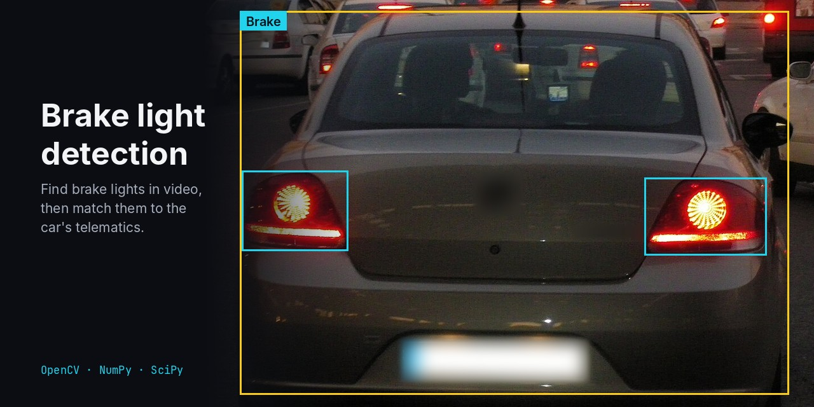
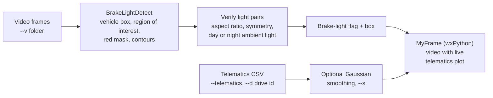

<p align="center"></p>

# Brake Light Detection and Telematics Data Visualization

<div style="text-align: center;">


</div>

This project combines brake light detection with the visualization of telematics data. It integrates the analysis of video frames with telemetry information to detect brake light events during vehicle drives. The code utilizes various Python libraries and frameworks to accomplish this task while providing insights into vehicle behavior and safety.

## How it works



## Code Overview

### BrakeLightDetect Class

The `BrakeLightDetect` class is responsible for detecting brake lights in video frames. It relies on OpenCV for image processing and employs color thresholding and contour analysis to identify brake lights. Key methods include:

- `getVehicleBbox`: Calculates the bounding box of a detected vehicle.
- `getRoI`: Extracts the Region of Interest (RoI) from an image based on polygon vertices.
- `getCroppedRedArea`: Extracts the red light exposure RoI from given contours.
- `getContours`: Analyzes masked images to extract contours.
- `resetAmbientLightFlags`: Resets flags related to ambient light and day/night detection.
- `getAmbientLight`: Estimates ambient light and updates the ambient light count.
- `getPolygonWidth`: Calculates the width of a polygon's bounding box.
- `getPairAspectRatio`: Measures the aspect ratio of pairs of possible brake lights.
- `breakLightVerificationCheck`: Verifies pairs of possible brake lights based on aspect ratio and symmetry.
- `detect`: Detects brake lights in provided contours and returns a flag and bounding box if detected.
- `get_ambient_light`: Provides information about ambient light conditions.
- `detect_brake_light`: Detects brake lights within a list of detected objects in an image and updates the list with brake light information.

### MyFrame Class

The `MyFrame` class is a GUI-based application for video frame analysis and data visualization. It uses the `BrakeLightDetect` class to detect brake lights in video frames and correlates this information with telematics data. Key functionalities include:

- Loading video frames and telematics data for analysis.
- Applying Gaussian smoothing to telematics data if specified.
- Displaying video frames and plotting telematics data in real-time.
- Correlating detected brake lights with video frames.
- Fast-forwarding frames if desired.

### Telematics Data

Telematics data typically includes information related to vehicle movement and behavior. It may consist of data such as vehicle speed, acceleration, braking events, and other relevant parameters. This data is crucial for understanding and analyzing vehicle safety and performance.


### Usage

To use this code, provide the necessary command-line arguments for speed, video data path, telematics data, and other options. The GUI-based application will display video frames, plot telematics data, and help you analyze the correlation between brake light events and vehicle telemetry.

Example Usage:

```bash
python main.py --speed 8 --v night_light --s False --d 8451e3f2-fd51-44c5-8588-d33276c7c11b --telematics telemetry_data.csv
```

- --speed: Adjusts the frame playback speed.
- --v: Specifies the folder path containing video frames.
- --s: Determines whether to apply Gaussian smoothing to telematics data (options: True or False).
- --d: Provides the drive ID (must be in the CSV file).
- --telematics: Specifies the path to the telematics data file.

### Dependencies
- OpenCV (cv2)
- NumPy (numpy)
- Pandas (pandas)
- SciPy (scipy.ndimage)
- Matplotlib (matplotlib)
- wxPython (wx)

Please ensure you have these libraries installed before running the code.

Note
- This code is designed to be part of a larger project involving brake light detection and the analysis of telematics data during vehicle drives. It provides a visual interface for correlating brake light events with vehicle behavior, making it useful for research and analysis in the field of vehicle safety and telematics.


## Setup

```bash
pip install opencv-python numpy pandas scipy matplotlib wxPython
```

## Limitations

Detection quality depends on lighting, camera angle, occlusion and the scope of the available driving data.

## Visual assets

The banner is a real photograph with detection boxes drawn on it, not a generated image. Photo: "Fiat Linea By Night" by Pava, public domain, [Wikimedia Commons](https://commons.wikimedia.org/wiki/File:Fiat_Linea_By_Night.jpg). Edits: cropped, the car-maker badge, model name and licence plate blurred, and the boxes drawn by hand in the style of this repo's demo UI (illustration, not model output). Provenance is in `docs/assets/hero-art.png.json`, the brief in `docs/assets/briefs/hero.md`, and the title text is set by `docs/assets/tools/compose_banner.py`. `docs/assets/social-preview.jpg` (1280x640) is for the repository's social preview. The demo GIFs above remain the evidence of the detector's output.
